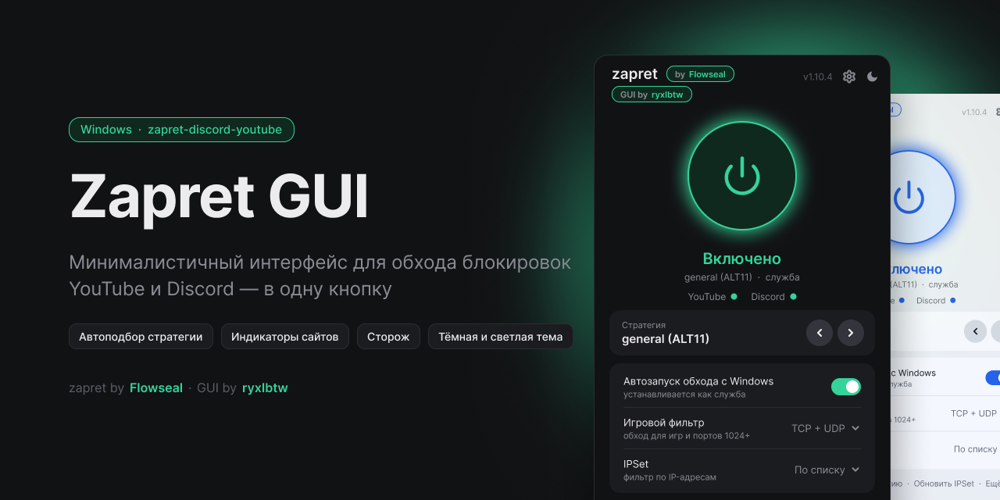
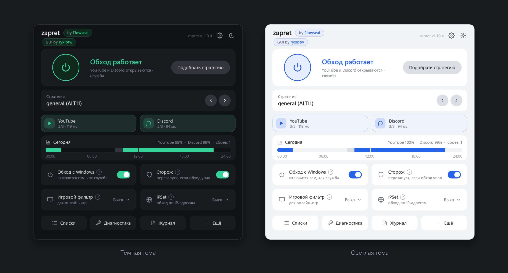

# Zapret GUI



Минималистичный интерфейс для [zapret-discord-youtube](https://github.com/Flowseal/zapret-discord-youtube) от **Flowseal**.
GUI by **ryxIbtw**.

[English below](#english)

## Установка

1. Скачайте и распакуйте [релиз zapret-discord-youtube](https://github.com/Flowseal/zapret-discord-youtube/releases/latest), например в `C:\zapret`.
2. Положите `ZapretGUI.exe` в эту папку, рядом с `service.bat`.
3. Запустите. Windows попросит права администратора: они нужны драйверу WinDivert.

## Возможности



**Главный экран**
- Большая кнопка включает и выключает обход. `winws.exe` работает в фоне, консольных окон нет.
- Индикаторы **YouTube ● Discord ●** раз в минуту проверяют, открываются ли сайты: зелёный — работает, жёлтый — частично, красный — нет. Клик по индикатору проверяет сразу.
- **Стратегия**: стрелки ‹ › или колесо мыши, клик по названию открывает список. Если обход включён, он сразу перезапускается с новой стратегией.
- **Подобрать стратегию** по очереди включает все стратегии, для каждой 3 раза проверяет YouTube и Discord и замеряет время ответа и скорость. В конце показывает таблицу от лучшей стратегии к худшей: лучшая выбрана сразу, но можно применить любую. Отменить можно кнопкой питания, тогда покажутся результаты по уже проверенным стратегиям. Колонка «История» показывает, как стратегия вела себя в прошлых подборах. Таблицу последнего подбора можно открыть через «Ещё».
- **Автозапуск обхода с Windows** (служба), **игровой фильтр** с портами, **IPSet**.
- **Ещё**: свои списки доменов и исключений, журнал событий, диагностика, классическое меню `service.bat`.
- **Редактор списков**: свои домены, исключения и IP-исключения редактируются прямо в программе: добавить (можно сразу несколько, ссылки вида `https://site.com/...` сами превращаются в домен), удалить, поиск. Кириллические домены переводятся в нужный zapret вид (punycode). При желании список можно открыть в Блокноте.

**Значок в трее**
- Левый клик открывает мини-панель над панелью задач: кнопка питания, стратегия со стрелками и индикаторы. Клик мимо панели её закрывает.
- Цвет значка показывает состояние: цветной — обход включён, серый — выключен, жёлтая точка — идёт подбор или другая операция.
- Правый клик открывает меню: «Открыть», «Включить/Выключить», «Выход».
- При наведении на индикаторы **YouTube ● Discord ●** видно, какие адреса открылись, за сколько миллисекунд и когда была проверка.

**Настройки** (шестерёнка)
- Язык: русский или английский.
- **Оформление**: тема «Как в Windows» (переключается вместе с системой), тёмная или светлая, а также цвет акцента: авто (зелёный в тёмной теме, синий в светлой), зелёный, синий, фиолетовый, оранжевый или розовый. На Windows 11 используется шрифт Segoe UI Variable.
- Запуск программы с Windows сразу в трей, через планировщик, без запроса UAC.
- Крестик сворачивает в трей или закрывает программу.
- **Сторож** перезапускает обход, если `winws.exe` упал (не больше 3 раз за 5 минут).
- **Диагностика** проверяет BFE, прокси, VPN, AdGuard, Killer, Check Point, SmartByte, DNS, путь установки, драйвер, hosts и другие программы обхода. Найденные проблемы исправляются кнопкой, кэш Discord очищается в один клик.
- **Fake-файлы** для Discord UDP и игрового фильтра.
- **Обновления**: ZapretGUI обновляет сам себя из релизов этого репозитория (скачивает новый exe и перезапускается, обход при этом продолжает работать). Перед установкой сверяется контрольная сумма SHA256 из релиза. Там же включается проверка обновлений при запуске.
- **Журнал событий**: когда обход включался и выключался, какая была стратегия, когда падал `winws.exe` и перезапускался сторожем, результаты подбора, обновления и ошибки. Кнопка «Копировать» копирует журнал вместе со сведениями о системе — удобно, когда просите помощи.
- **Резервная копия**: все настройки сохраняются в один `.zip` и загружаются обратно (свои списки, IPSet, игровой фильтр, fake-файлы, стратегия, тема, язык). Перед загрузкой текущие настройки автоматически сохраняются в `%APPDATA%\ZapretGUI\backups`.
- **О программе**: версия, ссылки на zapret и этот репозиторий, лицензия и SHA256 запущенного файла.
- **Обновление zapret в один клик**: программа скачивает релиз и заменяет файлы. Ваши списки, IPSet, игровой фильтр и fake-файлы сохраняются. Стратегии, которых нет в новой версии, не удаляются, а переносятся в папку `old-strategies\v<старая версия>`.

Настройки хранятся в тех же файлах, что использует `service.bat`, поэтому GUI и консольное меню можно использовать вперемешку.

## Проверка файла

К каждому релизу приложен `ZapretGUI.exe.sha256`. Сверить скачанный файл можно командой
`Get-FileHash ZapretGUI.exe` в PowerShell или в окне «О программе».

## Сборка

Нужна только Windows: используется встроенный компилятор .NET Framework 4.x.

```
powershell -ExecutionPolicy Bypass -File build.ps1
```

## Лицензия

Код интерфейса распространяется под лицензией [MIT](LICENSE). Это неофициальный интерфейс: сам zapret-discord-youtube принадлежит его авторам и распространяется под собственной лицензией MIT, в этот репозиторий он не входит.

---

## English

A minimal GUI for [zapret-discord-youtube](https://github.com/Flowseal/zapret-discord-youtube) by **Flowseal**. GUI by **ryxIbtw**.

Put `ZapretGUI.exe` next to `service.bat` in your zapret folder and run it (administrator rights are required by WinDivert).

Features: one-button on/off, live YouTube/Discord availability indicators, automatic strategy finder, Windows autostart (service), game filter, IPSet, watchdog, built-in diagnostics with one-click fixes, fake file switcher, one-click zapret update that keeps your lists and settings, built-in list editor, event log, settings backup/restore, self-update with SHA256 verification, tray mode, dark/light theme, Russian/English UI.

Each release ships `ZapretGUI.exe.sha256`; compare it with `Get-FileHash ZapretGUI.exe` or the About window.

Build: `powershell -ExecutionPolicy Bypass -File build.ps1`

License: [MIT](LICENSE). This is an unofficial GUI; zapret-discord-youtube itself belongs to its authors and is not included in this repository.
